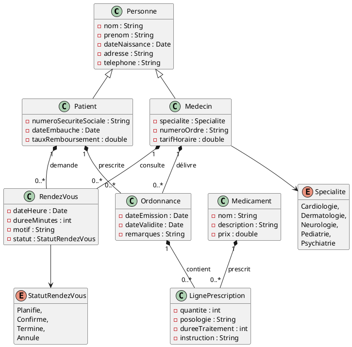

# Application de gestion d'un cabinet médical

## Description du projet et des fonctionnalités implémentées

**À COMPLÉTER**

## Membres du groupe

**À COMPLÉTER**

## Répartition du travail

**TABLEAU À COMPLÉTER**

| Membre du groupe | Tâches réalisées                             | Ticket associé |
|------------------|----------------------------------------------|----------------|
| Marie TIERS      | Ajout des logger aux classes GestionRendezVous, Recherche et Statistiques    | https://gitlab.univ-artois.fr/marie_tiers/gestion-cabinet-medical/-/work_items/12            |
| Ikram ALOULI     | Ajout des logger aux classes GestionOrdonnances, GestionPatients    | https://gitlab.univ-artois.fr/marie_tiers/gestion-cabinet-medical/-/work_items/11            |
| Loan BILCKE      | Ajout des logger aux classes Main, GestionMedecins, GestionMedicaments       | https://gitlab.univ-artois.fr/marie_tiers/gestion-cabinet-medical/-/work_items/10            |
| Marie TIERS             | Modification de Recherche.java et de Statistiques.java, puis des parties qui leur sont reliées dans Main.java                                           | ...            |
| Loan BILCKE              | Tests GestionMedecins, GestionRendezVous, LignePrescription                                          | https://gitlab.univ-artois.fr/marie_tiers/gestion-cabinet-medical/-/work_items/8 et https://gitlab.univ-artois.fr/marie_tiers/gestion-cabinet-medical/-/work_items/9           |
| Ikram ALOULI              | Tests sur GestionMedicaments, test GestionOrdonnances, test GestionPatients                                          | https://gitlab.univ-artois.fr/marie_tiers/gestion-cabinet-medical/-/work_items/8 et https://gitlab.univ-artois.fr/marie_tiers/gestion-cabinet-medical/-/work_items/9            |
| ...              | ...                                          | ...            |
| ...              | ...                                          | ...            |

## Présentation du code de base

### Diagramme des classes du modèle

### Diagramme des classes "services"

```plantuml
@startuml

top to bottom direction


class GestionMedecins {
  - medecins: List<Medecin>
  + rechercherParSpecialite(Specialite): List<Medecin>
  + ajouterMedecin(Medecin): void
  + rechercherParId(int): Medecin
  + mettreAJourMedecin(int, String, String, double, String, String, Specialite): void
  + getNombreMedecins(): int
  + afficherTousLesMedecins(): void
  + rechercherParNumeroOrdre(String): Medecin
  + listerTousLesMedecins(): List<Medecin>
  + rechercherParNom(String): List<Medecin>
  + supprimerMedecin(int): boolean
}
class GestionMedicaments {
  - medicaments: List<Medicament>
  + rechercherParId(int): Medicament
  + supprimerMedicament(int): boolean
  + ajouterMedicament(Medicament): void
  + listerTousLesMedicaments(): List<Medicament>
  + afficherTousLesMedicaments(): void
  + rechercherParNom(String): List<Medicament>
  + getNombreMedicaments(): int
}
class GestionOrdonnances {
  - ordonnances: List<Ordonnance>
  + listerToutesLesOrdonnances(): List<Ordonnance>
  + ajouterPrescription(int, Medicament, int, String, int, String): void
  + creerOrdonnance(Medecin, Patient, LocalDate, String): Ordonnance
  + getOrdonnancesMedecin(Medecin): List<Ordonnance>
  + getOrdonnancesValides(): List<Ordonnance>
  + getOrdonnancesPatient(Patient): List<Ordonnance>
  + afficherToutesLesOrdonnances(): void
  + rechercherParId(int): Ordonnance
  + getNombreOrdonnances(): int
}
class GestionPatients {
  - patients: List<Patient>
  + rechercherParNumeroSecu(String): Patient
  + mettreAJourPatient(int, String, String, String, String, String, double): void
  + afficherTousLesPatients(): void
  + supprimerPatient(int): void
  + ajouterPatient(Patient): void
  + listerTousLesPatients(): List<Patient>
  + rechercherParId(int): Patient
  + getNombrePatients(): int
  + rechercherParNom(String): List<Patient>
}
class GestionRendezVous {
  - rendezVous: List<RendezVous>
  + prendreRendezVous(Patient, Medecin, LocalDateTime, int, String): RendezVous
  + confirmerRendezVous(int): void
  + getRendezVousParStatut(StatutRendezVous): List<RendezVous>
  + terminerRendezVous(int): boolean
  + getRendezVousPatient(Patient): List<RendezVous>
  + rechercherParId(int): RendezVous
  + annulerRendezVous(int): void
  + getRendezVousMedecin(Medecin): List<RendezVous>
  + estDisponible(Medecin, LocalDateTime): boolean
  + getNombreRendezVous(): int
  + afficherTousLesRendezVous(): void
  + listerTousLesRendezVous(): List<RendezVous>
}
class Main {
  + main(String[]): void
}


Main                -[#595959,dashed]->  GestionMedecins    : "«create»"
Main                -[#595959,dashed]->  GestionMedicaments : "«create»"
Main                -[#595959,dashed]->  GestionOrdonnances : "«create»"
Main                -[#595959,dashed]->  GestionPatients    : "«create»"
Main                -[#595959,dashed]->  GestionRendezVous  : "«create»"
@enduml
```

