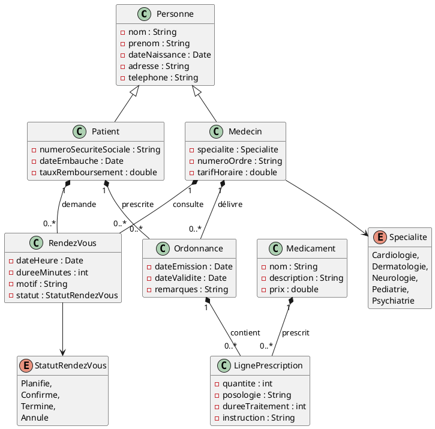

# Application de gestion d'un cabinet médical

## Description du projet et des fonctionnalités implémentées

L’objectif ici est de développer un système simple de gestion de dossiers médicaux pour un cabinet
médical. Ce système permettra de gérer les informations des patients, des médecins et des rendez‑
vous.  
L’application complète devra comporter les fonctionnalités suivantes :  
1. Gestion des patients : créer, lire, mettre à jour et supprimer les informations des patients.
2. Gestion des médecins : enregistrer les médecins avec leurs spécialisations.
3. Gestion des médicaments : créer et lister des médicaments.
4. Gestion des rendez‑vous : prendre, annuler et lister les rendez‑vous entre patients et médecins.
5. Gestion des ordonnances : permettre aux médecins de créer des ordonnances pour les patients,
en enregistrant les informations sur les médicaments prescrits, la posologie et la durée du trai‑
tement.
6. Module de recherche : implémenter des fonctionnalités de recherche pour trouver des patients
ou des médecins par nom, spécialité ou autre critère.
7. Module de statistiques : afficher des statistiques (nombre de médecins, de patients, médica‑
ments,…).

L'IDE utilisé est Eclipse, notre moteur de production pour Java est Gradle.

## Membres du groupe

__Groupe SAE n° 23__
Membres : 
- ALOULI Ikram (groupe 1B1)
- BILCKE Loan (groupe 1B1)
- TIERS Marie (groupe 1B2)

## Répartition du travail

| Membre du groupe | Tâches réalisées                             | Ticket associé |
|------------------|----------------------------------------------|----------------|
| Marie TIERS      | Ajout des logger aux classes GestionRendezVous, Recherche et Statistiques    | https://gitlab.univ-artois.fr/marie_tiers/gestion-cabinet-medical/-/work_items/12            |
| Ikram ALOULI     | Ajout des logger aux classes GestionOrdonnances, GestionPatients    | https://gitlab.univ-artois.fr/marie_tiers/gestion-cabinet-medical/-/work_items/11            |
| Loan BILCKE      | Ajout des logger aux classes Main, GestionMedecins, GestionMedicaments       | https://gitlab.univ-artois.fr/marie_tiers/gestion-cabinet-medical/-/work_items/10            |
| Marie TIERS             | Modification de Recherche.java et de Statistiques.java, puis des parties qui leur sont reliées dans Main.java                                           | https://gitlab.univ-artois.fr/marie_tiers/gestion-cabinet-medical/-/work_items/2 et https://gitlab.univ-artois.fr/marie_tiers/gestion-cabinet-medical/-/work_items/3            |
| Loan BILCKE              | Tests GestionMedecins, GestionRendezVous, LignePrescription                                          | https://gitlab.univ-artois.fr/marie_tiers/gestion-cabinet-medical/-/work_items/8 et https://gitlab.univ-artois.fr/marie_tiers/gestion-cabinet-medical/-/work_items/9           |
| Ikram ALOULI              | Tests sur GestionMedicaments, test GestionOrdonnances, test GestionPatients                                          | https://gitlab.univ-artois.fr/marie_tiers/gestion-cabinet-medical/-/work_items/8 et https://gitlab.univ-artois.fr/marie_tiers/gestion-cabinet-medical/-/work_items/9            |
| Ikram ALOULI              | Documentation service                                          | https://gitlab.univ-artois.fr/marie_tiers/gestion-cabinet-medical/-/work_items/17            |
| Loan BILCKE              | Documentation cabinet, enumeration et utils                                         | https://gitlab.univ-artois.fr/marie_tiers/gestion-cabinet-medical/-/work_items/15           |
| Marie TIERS              | Documentation modele                                          | https://gitlab.univ-artois.fr/marie_tiers/gestion-cabinet-medical/-/work_items/16            |
| Ikram ALOULI             | Vue de gestion médecins                                          | https://gitlab.univ-artois.fr/marie_tiers/gestion-cabinet-medical/-/work_items/14            |
| Loan BILCKE             | Vue de gestion médicaments                                          | https://gitlab.univ-artois.fr/marie_tiers/gestion-cabinet-medical/-/work_items/14            |
| Marie TIERS              | Vue de gestion rendez-vous                                           | https://gitlab.univ-artois.fr/marie_tiers/gestion-cabinet-medical/-/work_items/14            |

## Présentation du code de base

### Diagramme des classes du modèle

### Diagramme des classes "services"

```plantuml
@startuml

top to bottom direction


class GestionMedecins {
  - medecins: List<Medecin>
  + rechercherParSpecialite(Specialite): List<Medecin>
  + ajouterMedecin(Medecin): void
  + rechercherParId(int): Medecin
  + mettreAJourMedecin(int, String, String, double, String, String, Specialite): void
  + getNombreMedecins(): int
  + afficherTousLesMedecins(): void
  + rechercherParNumeroOrdre(String): Medecin
  + listerTousLesMedecins(): List<Medecin>
  + rechercherParNom(String): List<Medecin>
  + supprimerMedecin(int): boolean
}
class GestionMedicaments {
  - medicaments: List<Medicament>
  + rechercherParId(int): Medicament
  + supprimerMedicament(int): boolean
  + ajouterMedicament(Medicament): void
  + listerTousLesMedicaments(): List<Medicament>
  + afficherTousLesMedicaments(): void
  + rechercherParNom(String): List<Medicament>
  + getNombreMedicaments(): int
}
class GestionOrdonnances {
  - ordonnances: List<Ordonnance>
  + listerToutesLesOrdonnances(): List<Ordonnance>
  + ajouterPrescription(int, Medicament, int, String, int, String): void
  + creerOrdonnance(Medecin, Patient, LocalDate, String): Ordonnance
  + getOrdonnancesMedecin(Medecin): List<Ordonnance>
  + getOrdonnancesValides(): List<Ordonnance>
  + getOrdonnancesPatient(Patient): List<Ordonnance>
  + afficherToutesLesOrdonnances(): void
  + rechercherParId(int): Ordonnance
  + getNombreOrdonnances(): int
}
class GestionPatients {
  - patients: List<Patient>
  + rechercherParNumeroSecu(String): Patient
  + mettreAJourPatient(int, String, String, String, String, String, double): void
  + afficherTousLesPatients(): void
  + supprimerPatient(int): void
  + ajouterPatient(Patient): void
  + listerTousLesPatients(): List<Patient>
  + rechercherParId(int): Patient
  + getNombrePatients(): int
  + rechercherParNom(String): List<Patient>
}
class GestionRendezVous {
  - rendezVous: List<RendezVous>
  + prendreRendezVous(Patient, Medecin, LocalDateTime, int, String): RendezVous
  + confirmerRendezVous(int): void
  + getRendezVousParStatut(StatutRendezVous): List<RendezVous>
  + terminerRendezVous(int): boolean
  + getRendezVousPatient(Patient): List<RendezVous>
  + rechercherParId(int): RendezVous
  + annulerRendezVous(int): void
  + getRendezVousMedecin(Medecin): List<RendezVous>
  + estDisponible(Medecin, LocalDateTime): boolean
  + getNombreRendezVous(): int
  + afficherTousLesRendezVous(): void
  + listerTousLesRendezVous(): List<RendezVous>
}
class Main {
  + main(String[]): void
}


Main                -[#595959,dashed]->  GestionMedecins    : "«create»"
Main                -[#595959,dashed]->  GestionMedicaments : "«create»"
Main                -[#595959,dashed]->  GestionOrdonnances : "«create»"
Main                -[#595959,dashed]->  GestionPatients    : "«create»"
Main                -[#595959,dashed]->  GestionRendezVous  : "«create»"
@enduml
```

